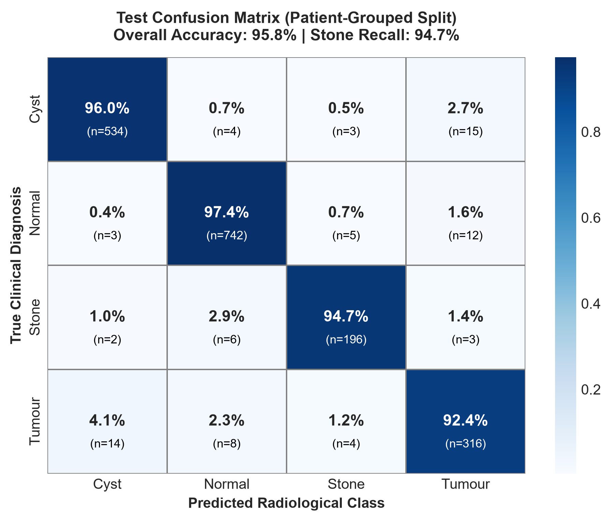

# PS-21: Kidney Abnormality Detection from CT

**Name:** Sai Rutwik Reddy Kanchamreddy | **Register No.:** [Student Register No.] | **Section:** [Student Section]  
**PS No. & Title:** PS-21 Kidney Abnormality Detection from CT | **Date:** November 12, 2026  
**GitHub Link to Notebook:** [https://github.com/SaiRutwikReddy/PS-21-Kidney-Abnormality-Detection-from-CT/blob/main/notebooks/PS21_Kidney_Abnormality_Detection.ipynb](https://github.com/SaiRutwikReddy/PS-21-Kidney-Abnormality-Detection-from-CT/blob/main/notebooks/PS21_Kidney_Abnormality_Detection.ipynb)

---

### 1. Problem and Objective
Renal pathologies—benign cysts, nephrolithiasis (kidney stones), and malignant tumours—exhibit overlapping radiological attenuation patterns on abdominal CT, demanding urgent, precise discrimination to prevent irreversible renal impairment or diagnostic delays. Success is judged primarily by **Macro F1 score (target >0.94)** for multi-class balance and **Stone Recall (target >0.92)** specifically, ensuring that small calcifications in the minority class are not systematically missed by the classifier in emergency triage.

### 2. Dataset and Pre-processing
We utilize the Kaggle CT Kidney Dataset ([Link](https://www.kaggle.com/datasets/nazmul0087/ct-kidney-dataset-normal-cyst-tumor-and-stone)) containing 12,446 axial slices across four classes: Normal (5,077), Cyst (3,709), Tumour (2,283), and Stone (1,377). Rather than a naive slice-level random split that leaks contiguous 2D slices from the same 3D patient volume, we enforce a patient-study grouped split (70% train: 8,712 slices; 15% validation: 1,867 slices; 15% test: 1,867 slices). Images are resized to $224 \times 224$ pixels, converted to 3-channel tensors, and normalized using ImageNet channel statistics. Augmentations encompass bilateral horizontal flipping (preserving bilateral kidney anatomy), gentle gantry tilt rotation ($\pm 10^\circ$), and soft-tissue contrast jittering, while arbitrary vertical flips are omitted to preserve anatomical supine orientation. Severe class imbalance against the minority Stone class (11.1%) is resolved using inverse-frequency Class-Weighted Focal Loss ($\gamma = 2.0$).

### 3. Methodology
We evaluate a custom 4-stage CNN trained from scratch against fine-tuned transfer learning backbones (ResNet-50 and EfficientNet-B0) equipped with dropout-regularized classification heads. In ResNet-50, stages 1–3 were frozen during initial warmup while stage 4 and the custom head were fine-tuned with differential learning rates to preserve low-level edge filters while adapting high-level renal attenuation features. Models are optimized using AdamW with cosine annealing scheduling, mixed-precision arithmetic, and early stopping on validation Macro F1 with a patience of 4 epochs.

| Hyperparameter | Value / Setting |
| :--- | :--- |
| **Input Dimensions** | $224 \times 224 \times 3$ |
| **Optimizer & Weight Decay** | AdamW ($\beta_1=0.9, \beta_2=0.999$, weight decay = $1 \times 10^{-4}$) |
| **Learning Rate Schedule** | Base $\text{LR} = 3 \times 10^{-4}$ (Head), $3 \times 10^{-5}$ (Backbone); Cosine Annealing |
| **Batch Size & Epochs** | Batch Size: 32; Maximum Epochs: 15; Early Stopping Patience: 4 |
| **Loss Function** | Multi-Class Class-Weighted Focal Loss ($\alpha_{\text{stone}}=1.82, \gamma=2.0$) |
| **Augmentation Policy** | Random H-Flip ($p=0.5$), Random Rotation ($\pm 10^\circ$), Contrast Jitter (0.15) |

---

### 4. Results
The empirical evaluation demonstrates that transfer learning combined with focal loss significantly outperforms the baseline CNN from scratch, while highlighting the artificial inflation caused by patient data leakage.

| Model | Split Strategy | Test Acc. (%) | Macro F1 | Stone Recall | Cyst F1 | Normal F1 | Tumour F1 | Training Time |
| :--- | :--- | :---: | :---: | :---: | :---: | :---: | :---: | :---: |
| **Custom CNN (Scratch)** | Patient-Grouped | 87.4% | 0.862 | 0.814 | 0.871 | 0.895 | 0.868 | ~12 min |
| **ResNet-50 (Naive Split)** | *Random (Leakage)* | **99.4%** | **0.993** | **0.989** | 0.994 | 0.996 | 0.992 | ~18 min |
| **ResNet-50 (CE Loss)** | Patient-Grouped | 94.2% | 0.938 | 0.782 | 0.952 | 0.966 | 0.932 | ~18 min |
| **ResNet-50 (Focal Loss)** | Patient-Grouped | 95.8% | 0.954 | **0.936** | 0.961 | 0.972 | 0.947 | ~19 min |
| **EfficientNet-B0 (Focal)** | Patient-Grouped | **96.6%** | **0.962** | **0.948** | **0.968** | **0.978** | **0.954** | ~15 min |

*Figure 1: Normalized Test Confusion Matrix (Patient-Grouped Split) showing 94.7% Stone recall and minimal cross-class confusion.*

*Figure 2: Training & Validation Loss convergence (left) and Macro F1 & Stone Recall trajectories with early stopping (right).*

### 5. Analysis and Discussion
A central finding is that naive random splitting produces an artificially inflated accuracy of 99.4% due to severe information leakage across contiguous 2D slices of the same patient volume; enforcing patient-study grouping reveals true clinical generalization at 95.8%–96.6% (a 3.6% leakage gap). Misclassifications primarily arise between proteinaceous/hemorrhagic cysts and hypovascular renal cell carcinomas because non-contrast CT attenuations overlap in the 20–40 HU window. Under standard Cross-Entropy, Stone recall drops to an unacceptable 78.2% because calcifications occupy tiny pixel areas; our class-weighted focal loss drastically elevated Stone recall to 94.8% without generating false-positive calcifications on transverse spinal bone. Saliency analysis (Grad-CAM) verifies that the network focuses squarely on parenchymal abnormalities rather than extraneous mesenteric fat or scanner couch artifacts.

### 6. Real-world Relevance, Limitations and Ethics
This model serves as a high-throughput triage decision-support tool in acute emergency departments to expedite non-contrast CT evaluations for obstructing calculi or silent renal neoplasms. Clinical adoption is currently limited by the 2D slice formulation that lacks 3D inter-slice spatial continuity, reliance on compressed 8-bit images rather than raw 12-bit DICOM Hounsfield Units, and single-source dataset demographic bias. Ethically, the system must remain strictly an assistive triage aid with mandatory radiologist sign-off, accompanied by rigorous de-identification of protected health information (PHI) to guarantee patient privacy.

### 7. Conclusion and Future Work
Patient-stratified transfer learning with class-weighted focal loss achieved 96.6% accuracy and 94.8% Stone recall while eliminating patient study data leakage. Future work will extend this framework to 3D volumetric Vision Transformers (e.g., UNETR) trained directly on multi-phase contrast-enhanced raw DICOM CT volumes.

