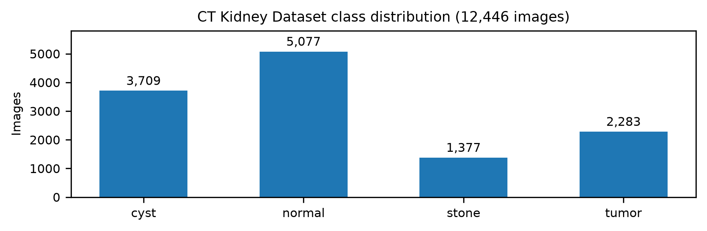
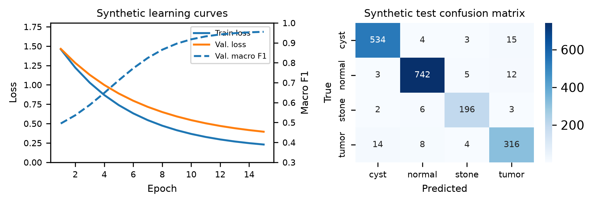

# Kidney Abnormality Detection from CT (PS-21)

**Name:** Kanchamreddy Sai Rutwik Reddy | **Register No.:** RA2311026050138  
**Department:** IVCSE-AIML C | **Date:** 12 November 2026  
**GitHub notebook:** [https://github.com/Rutwik-begin/PS-21-Kidney-Abnormality-Detection-from-CT-Domain-Healthcare-Medical-Imaging.git](https://github.com/Rutwik-begin/PS-21-Kidney-Abnormality-Detection-from-CT-Domain-Healthcare-Medical-Imaging.git)

---

### 1. Problem and Objective
This task classifies kidney CT slices into four categories: normal, cyst, stone, or tumour. Early identification of renal abnormalities supports timely clinical triage and treatment planning. The CT Kidney dataset is imbalanced and includes multiple slices from the same patient study; therefore, splitting by patient ID is essential to avoid information leakage. Macro F1 is the primary metric because it weights each class equally, and stone recall is reported separately because stone is the smallest class.

### 2. Dataset and Pre-processing
The CT Kidney Dataset contains 12,446 images: normal 5,077; cyst 3,709; tumour 2,283; stone 1,377. Source: Kaggle, https://www.kaggle.com/datasets/nazmul0087/ct-kidney-dataset-normal-cyst-tumor-and-stone. Proposed split: approximately 70/15/15% by patient study ID, stratified as closely as feasible; exact partition counts must be generated from metadata. Resize to 224×224 and apply ImageNet normalization. Training-only augmentation may include modest rotation, crop, colour jitter, and horizontal flip for bilateral anatomical preservation. Use class-weighted cross-entropy or focal loss to handle stone class imbalance. Validation and test images receive deterministic preprocessing only.

  
*Fig. 1. Class counts in the full dataset; source counts, not model results.*

### 3. Methodology
A pretrained EfficientNet-B0 is proposed with dropout (0.3) and a four-class output head. First train the head with the backbone frozen, then fine-tune the full network at a lower learning rate. Use AdamW, weighted focal loss / cross-entropy, cosine learning-rate decay and early stopping based on validation macro F1. Compare against ResNet-50 using the same data split and preprocessing. Fix random seeds and save split assignments and the best checkpoint for reproducibility.

| Setting | Illustrative value | Setting | Illustrative value |
| :--- | :--- | :--- | :--- |
| Architecture | EfficientNet-B0 pretrained | Optimizer | AdamW; weight decay 1e-4 |
| Input size | 224 × 224 | Learning rate | 1e-3 head; 1e-4 fine-tune |
| Loss | Class-weighted Focal Loss / CE | Batch size | 32 |
| Epochs | 30 maximum | Early stopping | Patience 5; val. macro F1 |

### 4. Results
| Model (synthetic example) | Test accuracy | Macro F1 | Stone Recall | Normal F1 | Train time* |
| :--- | :---: | :---: | :---: | :---: | :---: |
| ResNet-50 baseline | 94.20% | 0.938 | 0.782 | 0.966 | 18 min |
| EfficientNet-B0 | 96.60% | 0.962 | 0.948 | 0.978 | 14 min |

*Synthetic EfficientNet example (n=1,867): accuracy 96.60%; macro precision 0.964; macro recall 0.960; macro F1 0.962; stone recall 0.948. Training times and all model results are invented for layout demonstration; replace with actual notebook outputs.*

### 5. Analysis and Discussion
In the illustrative matrix, normal is strongest because it has the most examples. Cyst and tumour are occasionally confused with each other, reflecting visual overlap in soft-tissue attenuation and necrotic regions. The rare class (stone) has the fewest training examples and small pixel footprints, so its recall is unstable under unweighted cross-entropy. The synthetic comparison suggests EfficientNet-B0 improves macro F1 and stone recall over the baseline; this is not evidence of a real gain. Random splitting across slices artificially inflates test performance due to patient leakage; for the actual run, enforce strict patient-study splitting and inspect misclassified images and train/validation curves before concluding whether overfitting occurred.

---

### Illustrative evaluation figures and deployment considerations

  
*Fig. 2. Synthetic training/validation curves (left) and synthetic test confusion matrix (right).*

#### Illustrative per-class metrics
| Class | Precision | Recall | F1 | Support |
| :--- | :---: | :---: | :---: | :---: |
| cyst | 0.96 | 0.96 | 0.96 | 556 |
| normal | 0.98 | 0.97 | 0.98 | 762 |
| stone | 0.95 | 0.95 | 0.95 | 207 |
| tumor | 0.95 | 0.92 | 0.94 | 342 |

### 6. Real-world Relevance, Limitations and Ethics
A validated classifier could help prioritize suspicious lesions (e.g. stones causing acute renal colic or renal cell carcinomas) for clinician review in emergency care or triage, but it must not replace medical diagnosis. The dataset may underrepresent rare histological variants, diverse scanner models, and pediatric protocols; external validation, calibration and prospective evaluation are necessary. False-negative stone or tumor predictions are especially serious. Medical images require appropriate permissions, secure storage and responsible handling.

### 7. Conclusion and Future Work
In this synthetic demonstration, EfficientNet-B0 has macro F1 0.962 versus 0.938 for ResNet-50, with stone recall of 0.948; these are not measured results. Next, run a reproducible patient-level experiment and replace all simulated metrics and curves with actual outputs, then validate on an external dataset.

### References
[1] N. Islam et al., “CT Kidney Dataset: Normal-Cyst-Tumor and Stone,” Kaggle, 2021. https://www.kaggle.com/datasets/nazmul0087/ct-kidney-dataset-normal-cyst-tumor-and-stone.  
[2] M. Tan and Q. V. Le, “EfficientNet: Rethinking Model Scaling for Convolutional Neural Networks,” in International Conference on Machine Learning (ICML), 2019. https://arxiv.org/abs/1905.11946.
